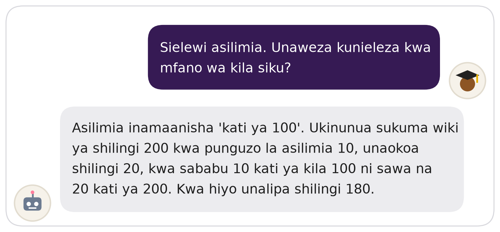

# Course 07 Practical Notebook: Accelerate Your Model

This 60-minute practical explores how **model size, precision and batch size affect the GPU memory** a language model needs, and how to make a model fit on a small device.

## 🎯 The challenge

Deploy a language model as a **maths tutor for students in Kenya**, running offline on a school laptop with a **4 GB GPU**.

  

*Learner: "I don't understand percentages. Can you explain them with an everyday example?" Tutor: "Percent means 'out of 100'. If you buy sukuma wiki for 200 shillings with a 10 percent discount, you save 20 shillings, because 10 out of every 100 is the same as 20 out of 200. So you pay 180 shillings."*

Working with **Gemma 3 1B** and **Gemma 3 4B**, you will answer:

1. Which model should we use: Gemma 3 1B or Gemma 3 4B?
2. How much GPU memory would it take to train the model?
3. How does the batch size change the memory needed for training?
4. How much memory does the model need to answer a learner's question?
5. How much memory can lower precision save, and at what cost?
6. Can the model run on a 4 GB laptop, so schools can use it offline?

## Before you begin

### 1. Open the notebook and save your own copy

Click **Open in Colab** above, then **File → Save a copy in Drive**. The badge opens a read-only copy, so without your own copy your work is lost when the tab closes.

### 2. Turn on a T4 GPU

**Runtime → Change runtime type → T4 GPU → Save**

### 3. Get access to the models

Set up **one** of these two options. The notebook detects which one you have.

**Option A: Hugging Face**

1. Go to [Hugging Face](https://huggingface.co/) → **Settings → Access Tokens**.
2. Click **Create new token**, give it a name, and select **Read** access.
3. Copy the token and add it to **Colab → Secrets** with the name `HF_TOKEN`.
4. Open the [Gemma 3 1B](https://huggingface.co/google/gemma-3-1b-it) and [Gemma 3 4B](https://huggingface.co/google/gemma-3-4b-it) model pages and accept the terms of use to get access.

**Option B: the copy on Google Drive**

No Hugging Face account? No worries. Open the `AIRF_Gemma` folder link your facilitator shares, right-click the folder, and choose **Organize → Add shortcut → My Drive**.

> 🤗 Even if you use Option B today, it is worth learning Hugging Face. It is where most open models, datasets and demos are shared.

## Notebook structure

| Section | What you do |
|---|---|
| 1. Estimate training memory | Write `training_memory_gb` |
| 2. Batch size and training memory | Explore it with a slider |
| 3. Estimate inference memory, then measure it | Write `inference_memory_gb`, then load Gemma 3 1B and measure it |
| 4. Precision and inference memory | Fill a table, then explore which setups fit in 4 GB |
| 5. Quantize Gemma with bitsandbytes | Build int8 and int4 configs, then compare memory, speed and responses |
| 6. 🎯 Challenge | Make Gemma fit on a 4 GB GPU |

## Completing the notebook

Complete the **TODO** cells and answer the reflection questions as you go. A hidden **Solutions** section at the end lets you check your answers after you have tried each task.

> Don't forget to have fun! 🚀🇰🇪
